# 任务五 JDBC 程序运行说明与功能测试

## 1. 第一次运行：编译并初始化管理员

任务四的数据中，管理员最初保存的是 SQL 测试占位哈希，不能直接使用管理员密码登录。如果已经成功初始化过管理员，跳过本节，直接从第 2 节启动。

在 PowerShell 中依次运行：

```powershell
cd .\CourseSelectionSystem
chcp 65001
[Console]::OutputEncoding = [System.Text.Encoding]::UTF8
mvn compile
$connector = "$env:USERPROFILE\.m2\repository\com\mysql\mysql-connector-j\9.7.0\mysql-connector-j-9.7.0.jar"
$java = if ($env:JAVA_HOME -and (Test-Path (Join-Path $env:JAVA_HOME 'bin\java.exe'))) { Join-Path $env:JAVA_HOME 'bin\java.exe' } else { (Get-Command java -ErrorAction Stop).Source }
Test-Path $connector
& $java '-Dfile.encoding=UTF-8' '-Dstdout.encoding=UTF-8' '-Dstderr.encoding=UTF-8' -cp "target/classes;$connector" edu.coursework.Main --initialize-admin
```

`Test-Path` 应显示 `True`。出现 `输入需求文档中固定的管理员初始密码:` 时，输入下面的系统管理员密码并按回车；输入时可能不显示字符：

```text
Q7!mV2#rK9@pL4$xN8%t
```

看到“管理员测试占位密码已初始化”表示成功。

## 2. 启动程序并登录管理员

在 PowerShell 中运行以下完整命令。即使新开终端，也会重新设置驱动路径：

```powershell
cd .\CourseSelectionSystem
chcp 65001
[Console]::OutputEncoding = [System.Text.Encoding]::UTF8
mvn compile
$connector = "$env:USERPROFILE\.m2\repository\com\mysql\mysql-connector-j\9.7.0\mysql-connector-j-9.7.0.jar"
$java = if ($env:JAVA_HOME -and (Test-Path (Join-Path $env:JAVA_HOME 'bin\java.exe'))) { Join-Path $env:JAVA_HOME 'bin\java.exe' } else { (Get-Command java -ErrorAction Stop).Source }
& $java '-Dfile.encoding=UTF-8' '-Dstdout.encoding=UTF-8' '-Dstderr.encoding=UTF-8' -cp "target/classes;$connector" edu.coursework.Main
```

出现提示后分别输入：


| 程序提示 | 输入                   |
| -------- | ---------------------- |
| `账号:`  | `admin`                |
| `密码:`  | `Q7!mV2#rK9@pL4$xN8%t` |

看到“登录成功”和管理员菜单后截图。**不要截取输入密码的过程。**下面第 3～6 节均在这个管理员菜单中操作，操作后会返回菜单。

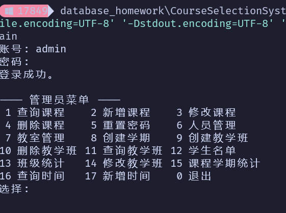

## 3. 新增课程、查询与重复编号检查

先查询现有课程：在 `选择:` 输入 `1`。程序显示课程列表；确认列表中没有 `C_SCREENSHOT_01`。如已有同名编号，请把以下步骤中的编号统一换成尚未使用的编号。

在管理员菜单依次操作：


| 提示      | 输入              |
| --------- | ----------------- |
| `选择:`   | `2`               |
| `课程号:` | `C_SCREENSHOT_01` |
| `课程名:` | `测试课程`        |

出现“添加成功”后，再在菜单输入 `1`，列表中应能看到该课程。程序的课程查询是**显示全部课程**，不是输入课程号查询。

继续测试重复编号：在菜单再次输入 `2`，课程号仍输入 `C_SCREENSHOT_01`，课程名输入 `重复课程测试`。程序应给出重复主键错误，原课程仍保留。

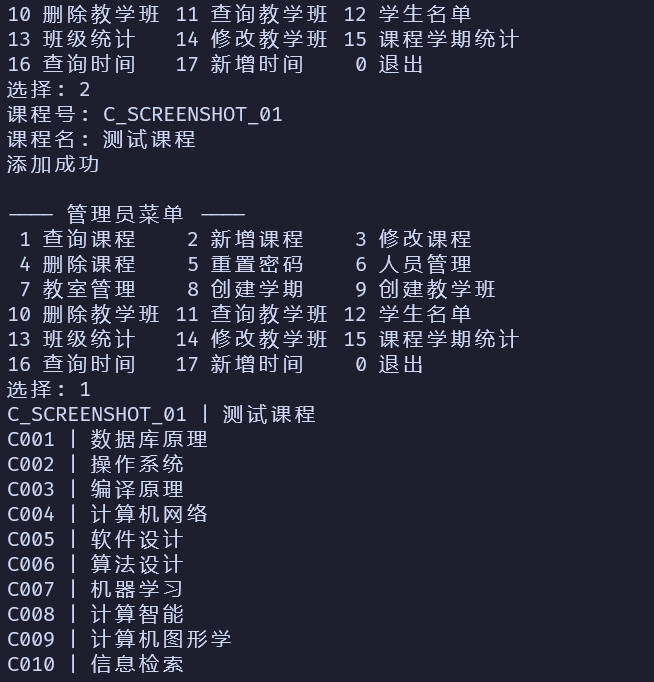

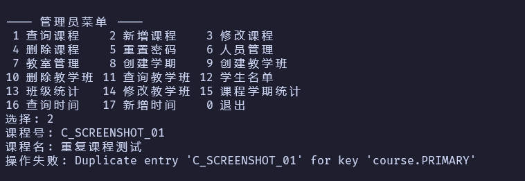

## 4. 修改与删除测试课程

仍在管理员菜单，先修改第 3 节新增的课程：


| 提示        | 输入               |
| ----------- | ------------------ |
| `选择:`     | `3`                |
| `课程号:`   | `C_SCREENSHOT_01`  |
| `新课程名:` | `修改后的测试课程` |

出现“更新记录数: 1”后输入 `1` 查询列表，确认课程名已修改。

再删除这条测试课程：


| 提示      | 输入              |
| --------- | ----------------- |
| `选择:`   | `4`               |
| `课程号:` | `C_SCREENSHOT_01` |

出现“删除记录数: 1”后输入 `1` 查询列表，确认该课程不再出现。只删除本节新增的测试课程。

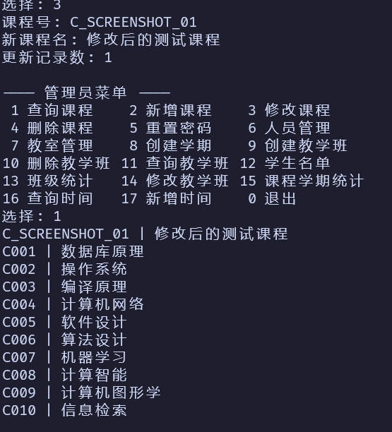

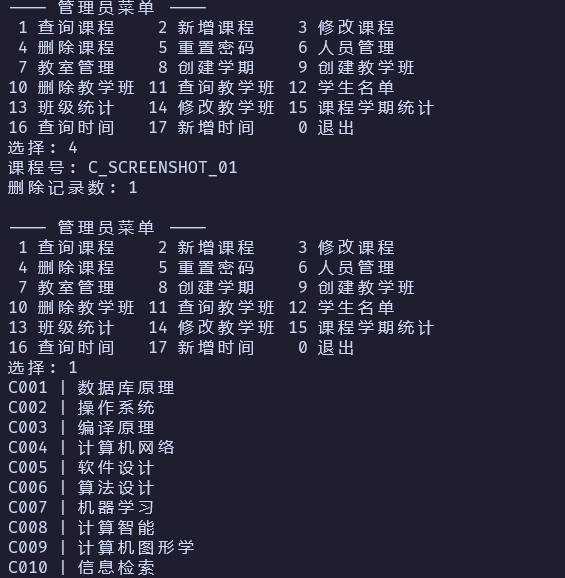

**修改不存在的课程：**先在管理员菜单输入 `1`，确认课程列表中没有 `C_MISSING`；随后依次输入：


| 提示        | 输入             |
| ----------- | ---------------- |
| `选择:`     | `3`              |
| `课程号:`   | `C_MISSING`      |
| `新课程名:` | `测试不存在课程` |

程序显示“更新记录数: 0”，说明没有记录被修改。

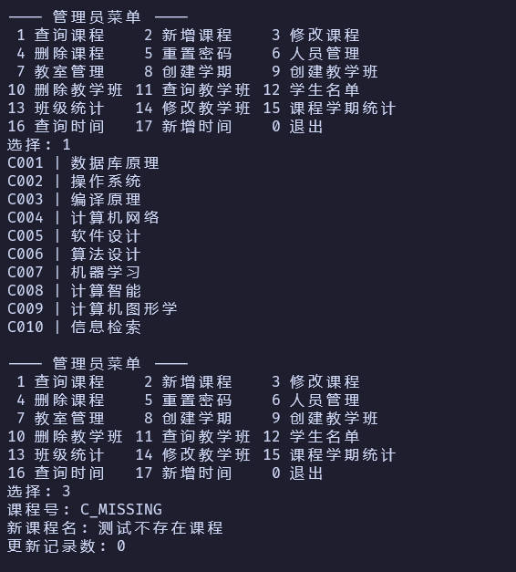

## 5. 检查外键限制

任务四初始化数据中的课程 `C001` 已被教学班引用。仍在管理员菜单，依次输入：


| 提示      | 输入   |
| --------- | ------ |
| `选择:`   | `4`    |
| `课程号:` | `C001` |

程序应返回外键约束错误，课程不会被删除。随后在菜单输入 `1`，可查看 `C001` 仍在课程列表中。如果你自行修改过初始化数据，请先确认 `C001` 确实仍被教学班引用，再执行此项。

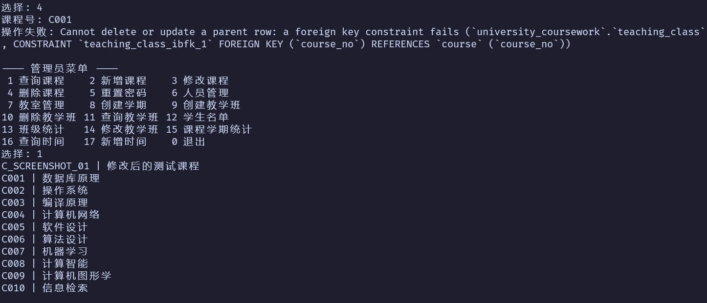

## 6. 管理员多表查询与统计

以下示例基于任务四原始测试数据：教学班 `2025-2026-2-001` 包含教师 `T001`、`T012` 和学生记录。如果你修改过这些数据，请按实际数据选择对应班号。

**查询课程、教师、时间和教室：**


| 提示                          | 输入     |
| ----------------------------- | -------- |
| `选择:`                       | `11`     |
| `教师姓名(直接回车显示全部):` | `教师01` |

结果中应显示 `2025-2026-2-001` 及该班的教师、上课节次和教室；教师姓名输入必须与数据库中的姓名一致。

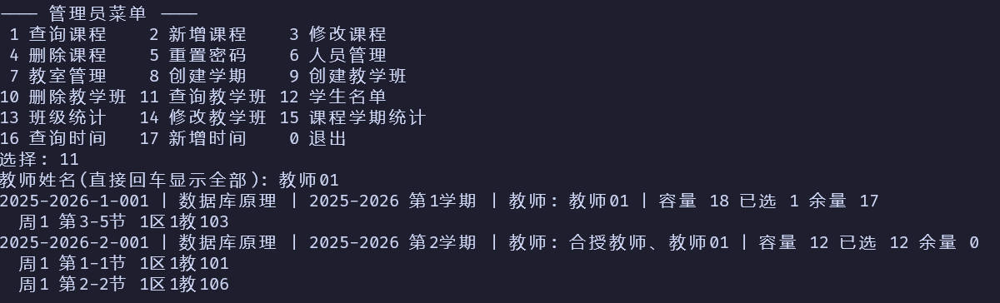

**查询有效选课学生名单和成绩：**


| 提示        | 输入              |
| ----------- | ----------------- |
| `选择:`     | `12`              |
| `教学班号:` | `2025-2026-2-001` |

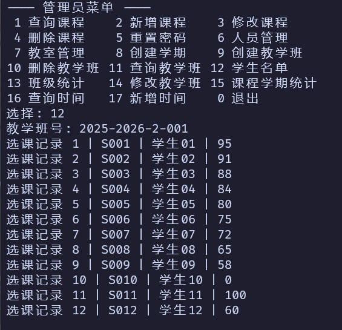

**查询班级统计：**


| 提示        | 输入              |
| ----------- | ----------------- |
| `选择:`     | `13`              |
| `教学班号:` | `2025-2026-2-001` |

**查询指定课程和学期的统计：**


| 提示      | 输入        |
| --------- | ----------- |
| `选择:`   | `15`        |
| `课程号:` | `C001`      |
| `学年:`   | `2025-2026` |
| `学期:`   | `2`         |

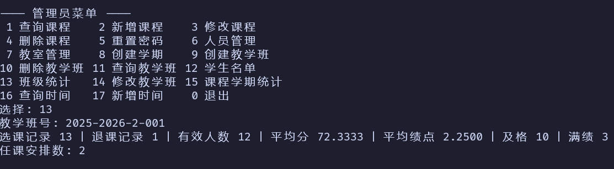

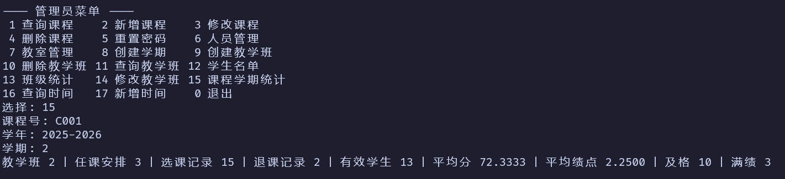

## 7. 设置学生、教师测试密码并登录

任务四原始学生和教师账号的密码同样是占位哈希，不能直接登录。下面操作会**修改当前数据库中这两个账号的密码哈希**；请仅对自己的测试账号执行。若密码已经设置，也可以直接用已设置的密码登录，不必重置。

在管理员菜单为学生设置密码：


| 提示              | 输入                         |
| ----------------- | ---------------------------- |
| `选择:`           | `5`                          |
| `学生或教师账号:` | `s000001`                    |
| `初始或重置密码:` | 输入一个你自己设置的测试密码 |

再在管理员菜单为教师设置密码：


| 提示              | 输入                         |
| ----------------- | ---------------------------- |
| `选择:`           | `5`                          |
| `学生或教师账号:` | `t000001`                    |
| `初始或重置密码:` | 输入一个你自己设置的测试密码 |

每次应显示“密码已设置”。菜单输入 `0` 退出程序，然后**重新运行第 2 节的 PowerShell 启动命令**。出现 `账号:` 输入 `s000001`，`密码:` 输入刚刚为该学生设置的密码。

登录学生后：


| 提示    | 输入 | 需要查看的结果               |
| ------- | ---- | ---------------------------- |
| `选择:` | `1`  | 本人选课记录与成绩           |
| `选择:` | `6`  | 本人课表，含课程、节次和教室 |
| `选择:` | `0`  | 退出学生账号                 |

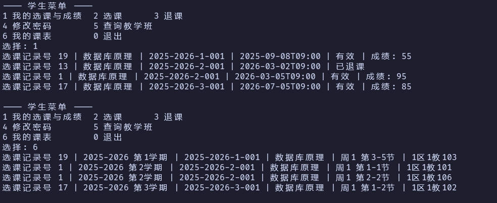

再次运行第 2 节启动命令，`账号:` 输入 `t000001`，密码输入刚刚为该教师设置的密码。登录后依次操作：


| 提示        | 输入              | 需要查看的结果     |
| ----------- | ----------------- | ------------------ |
| `选择:`     | `1`               | 本人任教的教学班   |
| `选择:`     | `5`               | 准备查询学生名单   |
| `教学班号:` | `2025-2026-2-001` | 该班有效学生及成绩 |
| `选择:`     | `6`               | 准备查询班级统计   |
| `教学班号:` | `2025-2026-2-001` | 该班统计结果       |
| `选择:`     | `0`               | 退出教师账号       |

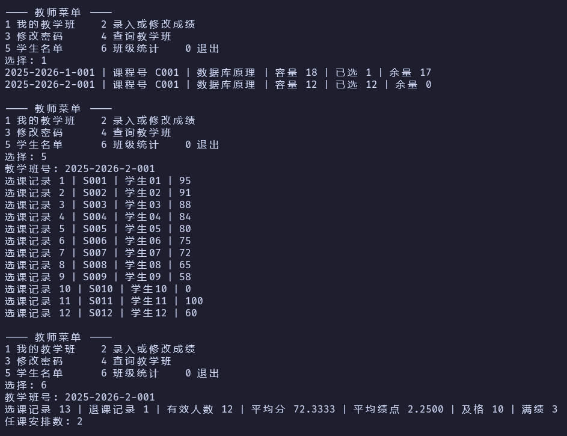

## 8. 选课、退课和事务回滚测试

任务四示例教学班属于历史学期；程序按当前北京时间检查选退课窗口，不能保证现在能对这些班级执行成功选课。不要修改电脑系统时间，也不要把历史教学班的拒绝结果当成选课成功。

本项目的隔离测试脚本会自行创建独立测试库和符合窗口的测试数据，验证选课、退课、重复选课拒绝、成绩及选课事务中途失败后的回滚。先退出 Java 程序（菜单输入 `0`），在 PowerShell 执行：

```powershell
cd .\CourseSelectionSystem
chcp 65001
[Console]::OutputEncoding = [System.Text.Encoding]::UTF8
python .\run_integration_test.py
```

测试需要事先设置过的 MySQL 登录路径 `coursework`。成功时逐项显示 `PASS`，最后显示“本次隔离测试库已清理”。其中“中途失败必须回滚选课记录”“中途失败必须保持人数”“写历史失败应回滚成绩”是回滚验证结果。脚本只删除本次随机创建的测试库，不删除 `university_coursework`。

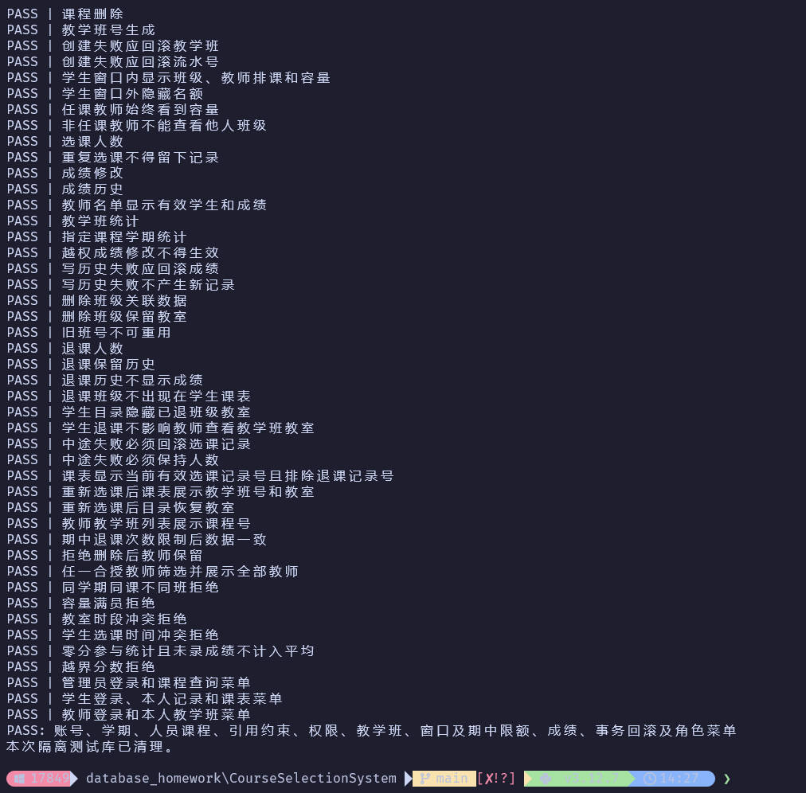

## 9. 退出程序并截图

管理员、学生或教师菜单出现 `选择:` 时输入 `0` 并回车。程序退出并返回 PowerShell 提示符。将程序退出与终端提示符一起截图，可补充展示连接资源释放后的程序退出；连接已关闭由代码中的 try-with-resources 管理，截图本身只能证明程序退出。

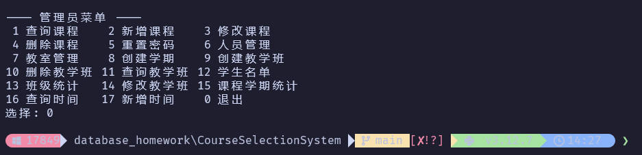

## 10. 功能测试记录

下表根据已有运行截图和用户在本机运行隔离测试的真实反馈填写。**隔离测试通过**表示程序自动断言通过。测试使用随机隔离库，运行后已清理。


| 编号 | 测试输入 / 操作              | 预期结果                           | 实际结果与证据                                         | 是否通过 | 问题与修复 |
| ---- | ---------------------------- | ---------------------------------- | ------------------------------------------------------ | -------- | ---------- |
| 01   | `admin` 登录                 | 成功连接数据库并进入菜单           | 登录成功，见第 2 节截图                                | 通过     | 无         |
| 02   | 新增 `C_SCREENSHOT_01`       | 课程写入并可查询                   | 显示“添加成功”，课程列表可见，见第 3 节截图            | 通过     | 无         |
| 03   | 重复添加已有课程编号         | 唯一约束拒绝，原记录保留           | 程序拒绝重复 `C_SCREENSHOT_01`，见第 3 节截图          | 通过     | 无         |
| 04   | 查询课程列表                 | 返回已有课程                       | 显示 `C001` 等课程，见第 3 节截图                      | 通过     | 无         |
| 05   | 修改不存在课程 `C_MISSING`   | 影响行数为 0                       | 更新记录数为 0，见第 4 节截图                          | 通过     | 无         |
| 06   | 修改 `C_SCREENSHOT_01`       | 名称更新并可查询                   | 更新记录数为 1，列表显示新名称，见第 4 节截图          | 通过     | 无         |
| 07   | 删除无引用测试课程           | 删除成功，查询不到                 | 删除记录数为 1，列表已无测试课程，见第 4 节截图        | 通过     | 无         |
| 08   | 删除被引用的 `C001`          | 外键拒绝，课程保留                 | 外键约束报错且列表仍显示 `C001`，见第 5 节截图         | 通过     | 无         |
| 09   | 查询学生选课、成绩和课表     | 展示本人有效与历史选课、成绩和课表 | 见第 7 节学生截图                                      | 通过     | 无         |
| 10   | 查询教学班、教师、时段与教室 | 按教师姓名返回多表结果             | 查询 `教师01` 返回班级及排课，见第 6 节截图            | 通过     | 无         |
| 11   | 查询学生名单和成绩           | 返回指定教学班有效学生             | 班级 `2025-2026-2-001` 的名单和成绩可见，见第 6 节截图 | 通过     | 无         |
| 12   | 正常选课与退课               | 选课记录和有效人数一致             | 隔离测试断言通过，见第 8 节截图                        | 通过     | 无         |
| 13   | 重复选课、满员、冲突         | 拒绝操作且数据保持一致             | 隔离测试断言通过，见第 8 节截图                        | 通过     | 无         |
| 14   | 选课事务中途失败             | 选课记录和人数回滚                 | 故障注入检查为 PASS，见第 8 节截图                     | 通过     | 无         |
| 15   | 成绩更新后写历史失败         | 成绩和历史记录回滚                 | 故障注入检查为 PASS，见第 8 节截图                     | 通过     | 无         |
| 16   | 退出程序                     | 正常退出并释放连接资源             | 正常返回终端，见第 9 节截图                            | 通过     | 无         |
