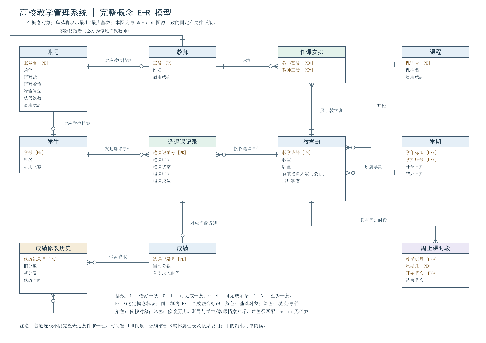
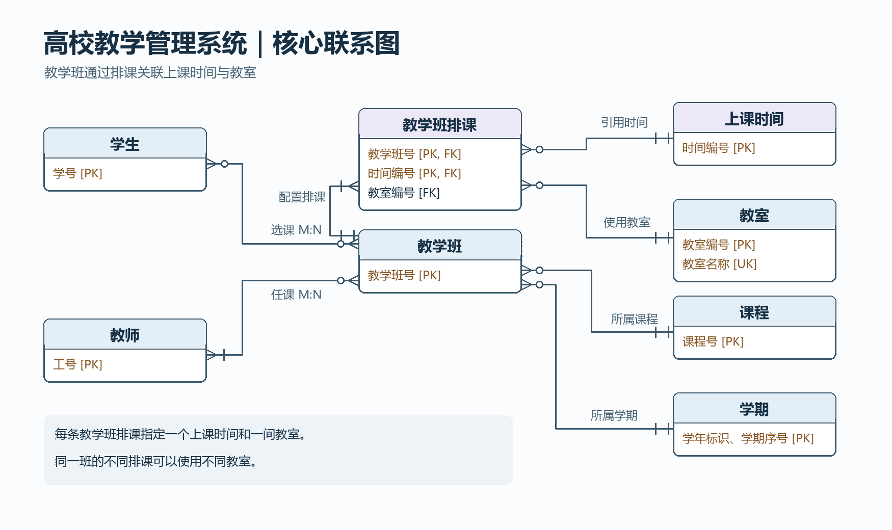

# 高校教学管理系统数据库概念结构设计

> 本文整理任务二的概念设计结果。实体定义和约束详见[定稿正文](高校教学管理系统_数据库概念结构设计.md)。

## 1. 实体、属性与标识

| 实体或关联对象 | 主要属性 | 选定标识 |
|---|---|---|
| 账号 | 账号名、角色、密码哈希 | 账号名 |
| 学生 | 学号、姓名 | 学号 |
| 教师 | 工号、姓名 | 工号 |
| 课程 | 课程号、课程名 | 课程号 |
| 学期 | 学年标识、学期序号、开学日期、结束日期 | 学年标识＋学期序号 |
| 教学班 | 教学班号、容量、有效选课人数 | 教学班号 |
| 上课时间 | 时间编号、星期几、开始节次、结束节次 | 时间编号 |
| 教室 | 教室编号、教室名称 | 教室编号 |
| 教学班排课 | 对应教学班、上课时间和教室 | 教学班号＋时间编号 |
| 任课安排 | 对应教学班和教师 | 教学班号＋教师工号 |
| 选退课记录 | 选课记录号、选课时间、状态、退课时间、退课类型；关联学生和教学班 | 选课记录号 |
| 成绩 | 当前分数、首次录入时间；关联选退课记录 | 所属选课记录号 |
| 成绩修改历史 | 修改记录号、旧分数、新分数、修改时间；关联成绩和修改教师 | 修改记录号 |

星期几、开始节次和结束节次的组合也是上课时间的候选标识。教室名称在全校唯一。学生和教师也可通过各自绑定的账号唯一定位。

## 2. 实体联系

| 联系 | 基数与说明 |
|---|---|
| 账号与学生、教师 | 每名学生或教师对应一个账号。一个账号最多绑定一个学生或教师身份，且身份与角色一致；管理员账号不绑定人员。 |
| 课程、学期与教学班 | 每个班只属于一门课程和一个学期。一门课程可开多个班，一个学期也可有多个班。 |
| 教学班与上课时间 | 多对多，通过教学班排课关联。每班至少有一条排课，每条排课指定一个时段和一间教室。同一班不同时段可以使用不同教室。 |
| 教师与教学班 | 多对多，通过任课安排关联。每班至少有一名教师，同一教师在同一班只安排一次。 |
| 学生与教学班 | 多对多，通过选退课记录关联。退课更新原记录，重选另建一条，因此同一学生和教学班之间可以有多条历史记录。 |
| 选退课记录与成绩 | 一次选课最多对应一份当前成绩。未录入时没有成绩记录，0 分是有效成绩。 |
| 成绩、教师与成绩修改历史 | 一份成绩可以有多条修改历史。每条历史对应一份成绩和一名修改教师，修改教师须任教该班。 |

## 3. 设计约束

- 班号按所属学期编号。建班后班号和所属学期固定，删班后不重复使用已发出的班号。
- 同班的排课时段不能重叠。同一学期内，时段重叠的班不能共用教室或任课教师。同一课程在同一学期的各班每周总课时相同，具体时段可以不同。
- 同一学生在同一学期对同一课程最多保留一条有效选课记录。教学班保存有效选课人数，人数须与有效记录数一致；剩余名额按容量减去有效人数计算。
- 成绩只关联有效选课。已录成绩的选课记录不能退课；每次改分保留旧分数、新分数、修改教师和修改时间。绩点由当前分数换算，不单独保存。
- 删除教学班时，清除该班的排课、任课安排、选退课记录、成绩和改分历史，保留共享的上课时间、教室及其他班的数据。

## 4. E-R 图

完整 E-R 图列出 13 个实体及关联对象，并展开排课、任课和选退课联系。

核心联系图直接标出教学班与上课时间、教师、学生之间的多对多联系。

