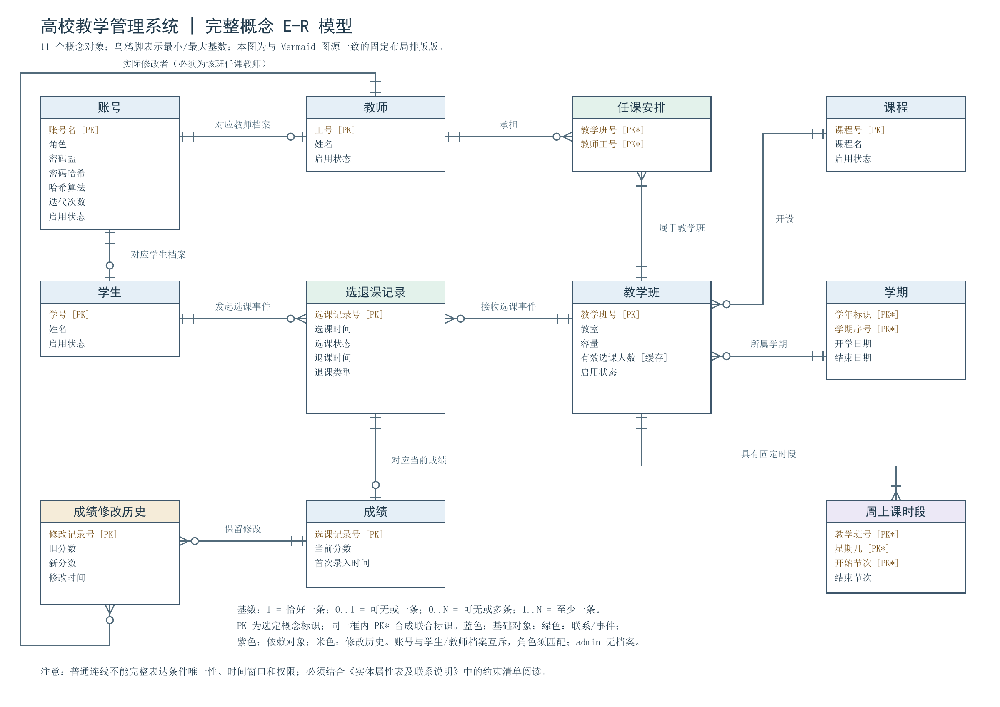
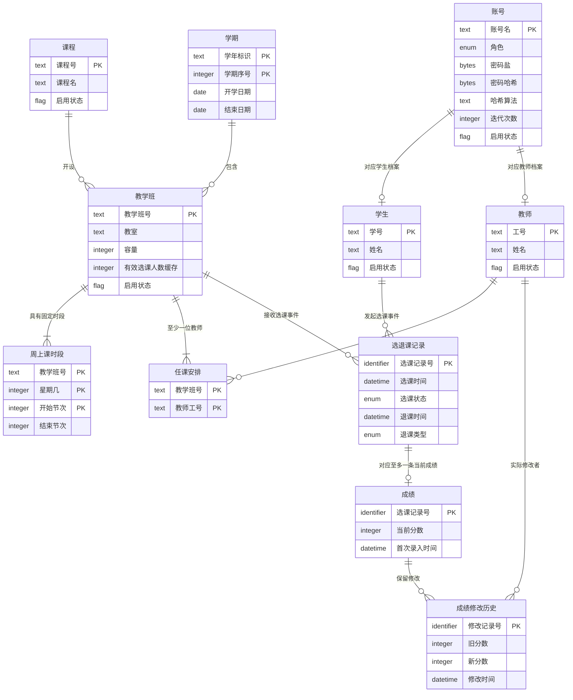
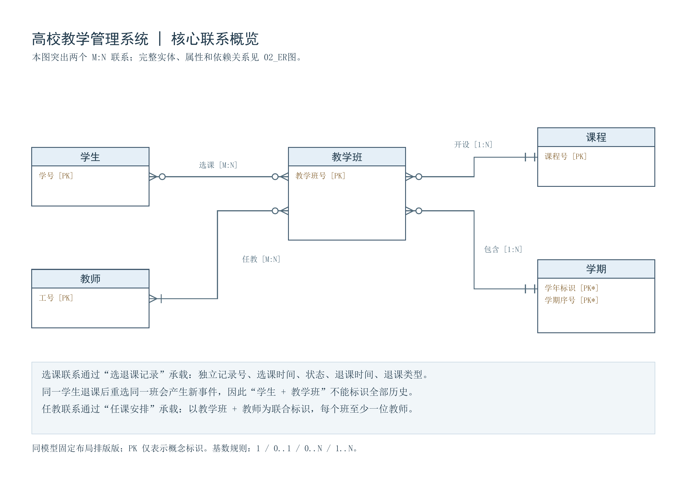

# 高校教学管理系统数据库概念结构设计

## 1. 背景与范围

本设计整理了高校教学管理系统数据库的实体、属性、候选标识、实体联系和 E-R 图。系统管理账号、学生、教师、课程、学期、教学班、固定上课时段、任课安排、选退课和成绩，支持多教师合授、退课后重选及成绩修改历史。

沿用任务一的范围：单用户顺序操作，全学期每周重复固定节次，一班一个教室，全部任课教师占用本班全部时段。不增加并发选课、自动排课、院系、专业、行政班、学费、考勤或通用操作审计。成绩修改历史属于成绩业务记录。

本阶段形成概念模型。表中的属性域表示业务含义，图中的 PK 表示选定的概念标识；SQL 数据类型与长度、主外键落点、索引、关系模式和范式分析由后续任务完成。

## 2. 实体与属性

模型共包含 11 个实体型及关联对象。候选标识指能够最小地唯一识别对象的属性集合，不根据姓名、课程名、日期或时间戳擅自推定唯一性。学生、教师和课程采用满足当前业务的最少基础字段。

| 编号 | 实体或关联对象 | 主要属性 | 候选标识及选定标识 | 设计依据 |
|---|---|---|---|---|
| E01 | 账号 | 账号名、角色、密码算法、迭代次数、密码盐、密码哈希、启用状态 | 账号名。 | 统一管理登录身份、角色权限及密码参数；管理员以 admin 账号和角色表示。 |
| E02 | 学生 | 学号、姓名、启用状态 | 学号；专属账号也可通过一对一联系唯一定位学生。选定学号。 | 学生业务身份与登录身份分离，不假定学号等于账号后六位。 |
| E03 | 教师 | 工号、姓名、启用状态 | 工号；专属账号也可通过一对一联系唯一定位教师。选定工号。 | 支持教师资料、合授安排和成绩修改人追溯。 |
| E04 | 课程 | 课程号、课程名、启用状态 | 课程号。 | 课程可跨学期开设多个教学班，排课和容量属于教学班。 |
| E05 | 学期 | 学年标识、学期序号、开学日期、结束日期 | （学年标识，学期序号）。 | 区分不同学期，统一确定开学日期及选退课时间窗口。 |
| E06 | 教学班 | 教学班号、教室、容量、有效选课人数、启用状态 | 全校永久唯一的教学班号。 | 表示某课程在某学期的一次开班；课程与学期的组合不能区分同课多班。 |
| E07 | 周上课时段 | 星期几、开始节次、结束节次；依赖所属教学班 | （教学班号，星期几，开始节次）；（教学班号，星期几，结束节次）也是候选标识。选定前者。 | 一班可有多个互不重叠的连续节次区间，时段不能脱离教学班独立存在。 |
| E08 | 任课安排 | 对应教学班、对应教师；无额外联系属性 | （教学班号，教师工号）。 | 承载教师与教学班的多对多联系，同班同教师只安排一次。 |
| E09 | 选退课记录 | 选课记录号、选课时间、状态、退课时间、退课类型；关联学生和教学班 | 独立的选课记录号。 | 同一学生退课后可重选同班，必须区分多次选课事件。 |
| E10 | 成绩 | 当前分数、首次录入时间；依赖所属选课记录 | 所属选课记录号。 | 一次选课至多有一份当前成绩，未录入时没有成绩对象。 |
| E11 | 成绩修改历史 | 修改记录号、旧分数、新分数、修改时间；关联成绩和修改教师 | 独立的修改记录号。 | 每次修改单独留痕，保留历史分数及实际修改人。 |

### 2.1 基础属性与取值约束

| 对象 | 属性要求 |
|---|---|
| 账号 | 账号名为 admin、s 加六位数字或 t 加六位数字；角色分别为管理员、学生、教师，必须匹配。密码算法为 PBKDF2WithHmacSHA256，迭代 600000 次，每个账号保存独立的 16 字节盐及哈希，不保存明文密码。管理员初始化规则沿用任务一。 |
| 学生、教师、课程 | 各自标识、姓名或课程名、启用状态必填。姓名及课程名允许重复，账号名不替代学号或工号。 |
| 学期 | 学年标识与学期序号联合唯一；序号为正整数，不擅自限定每学年只有两个学期。开学日期为周日，创建后不可修改；结束日期不早于开学日期。 |
| 教学班 | 班号格式为“学年标识-学期序号-流水号”，如 2024-2025-1-001；教室采用统一标识。容量为正整数，创建后固定；有效选课人数为非负整数，不超过容量。所属课程、学期、时段和教师通过联系表达。 |
| 周上课时段 | 星期几按周一至周日编码为 1 至 7；开始、结束节次均为正整数，结束不小于开始，区间含首尾。每班至少一个时段，同班时段互不重叠；一天最多几节留给实际作息规则确定。 |
| 选退课记录 | 每条记录必须关联一名学生和一个教学班，选课时间必填。状态为“有效”或“已退课”；有效时退课时间和类型均为空，已退课时均必填，类型为常规或期中，退课时间不早于选课时间。 |
| 成绩 | 成绩对象存在时，当前分数和首次录入时间必填。分数为 0 至 100 的整数，缺考录入 0 分；首次录入时间不得早于选课时间，修改时不能重置该时间。 |
| 成绩修改历史 | 旧分数、新分数均为 0 至 100 的整数。每条历史必须对应一份成绩和一名实际修改教师，修改时间处于首次录入后不超过 168 小时的范围内。首次录入不记作一次修改。 |

周时段的标识必须包含所属教学班。同班同一天两个区间若开始节次相同或结束节次相同，必然重叠，因此两个联合候选标识都成立；没有必要把开始、结束节次全部加入选定标识。

选退课记录不能用“学生＋教学班”作为全部历史的唯一标识，也不能仅靠选课时间保证唯一。成绩按一次选课识别，不能用“学号＋课程号”混合不同学期的成绩。

## 3. 实体联系

下表中的数量按单个对象解释：给定左方一个对象，可关联多少右方对象；反方向同理。0..N 表示零个或多个，1..N 表示至少一个。

| 编号 | 左方—联系—右方 | 左方对应右方 | 右方对应左方 | 设计依据 |
|---|---|---|---|---|
| R01 | 账号—学生身份—学生 | 0..1 | 1 | 每名学生恰有一个学生账号，其他角色账号没有学生身份。 |
| R02 | 账号—教师身份—教师 | 0..1 | 1 | 每名教师恰有一个教师账号，其他角色账号没有教师身份。 |
| R03 | 课程—开设—教学班 | 0..N | 1 | 课程可以尚未开班，也可在同学期或跨学期开多个班。 |
| R04 | 学期—安排—教学班 | 0..N | 1 | 学期可以先建立，每个教学班只属于一个学期。 |
| R05 | 教学班—包含—周上课时段 | 1..N | 1 | 教学班至少有一个固定上课时段。 |
| R06 | 教师—承担—任课安排 | 0..N | 1 | 教师可以暂未任课，也可参与多个班。 |
| R07 | 教学班—配置—任课安排 | 1..N | 1 | 每班至少一位教师，允许多教师合授。 |
| R08 | 学生—产生—选退课记录 | 0..N | 1 | 学生可以没有选课，也可产生多次选退课记录。 |
| R09 | 教学班—接收—选退课记录 | 0..N | 1 | 新班可以无人选课，历史记录总数不直接受容量限制。 |
| R10 | 选退课记录—取得—成绩 | 0..1 | 1 | 未录入时无成绩，录入后只保留一份当前成绩。 |
| R11 | 成绩—保留—成绩修改历史 | 0..N | 1 | 成绩可以从未修改，每次修改都保留独立历史。 |
| R12 | 教师—执行—成绩修改历史 | 0..N | 1 | 每次修改恰由一位教师执行，教师必须任教对应教学班。 |

### 3.1 一对一与多对多联系

账号与学生、账号与教师，以及选课记录与成绩，最大基数均为一对一。学生和教师必须拥有对应账号；账号的学生、教师绑定互斥且与角色匹配，admin 两者均不绑定。这项互斥规则需要文字补充，不能仅由两条可选一对一连线保证。

教师与教学班为多对多联系，通过任课安排表达。任课安排没有需求之外的主讲身份、顺序或比例属性，不额外设置无用途的任课安排号。不能把多名教师拼接到教学班的一个属性中。

学生与教学班为多对多联系，通过选退课记录表达。选课时间、状态和退课信息属于一次选课事件。退课更新原记录，重选新增记录，保留完整历史；同一对学生与教学班可以有多条历史，但至多一条有效记录。

## 4. E-R 图

完整图包含全部 11 个对象及 12 条联系。图中的 text、integer、date 等为概念属性域；多列 PK 表示联合标识。图中的“哈希算法”“有效选课人数缓存”“选课状态”分别对应上表的密码算法、有效选课人数和状态。

以下为对应的可编辑 Mermaid 代码；使用不支持 Mermaid 的阅读器时，可直接查看上图。

核心联系图突出两个多对多联系，便于阅读；它与完整图表达同一模型，不代表还要额外保存两组重复联系。

## 5. 业务约束清单

E-R 图表示结构和联系基数。条件唯一性、时间窗口、权限、冻结和事务一致性需由文字补充，并在后续数据库及应用设计中落实。

| 编号 | 规则 | 对应需求 | 后续保障方式 |
|---|---|---|---|
| C01 | 各标识唯一，账号格式、角色和人员绑定匹配且互斥；人员停用同步停用账号。学生和教师可修改本人密码或由管理员重置，管理员密码永久固定。 | BR-02、BR-03、BR-13 | 唯一性与引用约束，统一创建、停用及权限校验流程。 |
| C02 | 每个教学班恰属一门课程和一个学期，至少一个上课时段、至少一位教师；全部任课教师占用本班全部时段。 | BR-04 | 创建教学班时完整保存班、时段和任课安排，避免半成品。 |
| C03 | 同班时段不重叠；同学期跨班时段重叠时不得使用同一教室或共享教师，不重叠时可复用。 | FR-01、BR-04 | 校验星期、节次范围并查询相关时段与任课安排；不能仅用单行 CHECK 判断跨行冲突。 |
| C04 | 同课程同学期各班每周总课时相同，具体时段可以不同。 | FR-01、BR-04 | 对各班时段的“结束节次－开始节次＋1”求和比较；允许修改课程、学期或时段时重新核验。 |
| C05 | 同一学生、同一学期、同一课程最多一条有效选课；已退历史及其他学期不阻止选课。 | BR-06、BR-12 | 校验有效记录及班所属课程、学期，不对全部历史设置“学生＋班”无条件唯一限制。 |
| C06 | 新选班不得与本学期已有有效选课时段重叠。 | BR-12 | 沿有效选课定位教学班及时段，按区间相交规则核验。 |
| C07 | 有效人数＝当前有效选课记录数，且 0≤有效人数≤容量；成功选课加一、退课减一，记录与缓存同一事务更新，失败全部回滚。 | BR-05、BR-11 | 单对象范围约束、计数核对和选退课事务；跨表计数一致性不能仅靠 CHECK。 |
| C08 | 退课保留原记录及时间、类型；重选新增记录。有效记录无退课信息，已退记录的两项退课信息必须齐全。 | FR-04、BR-06 | 状态与字段一致性检查及退课流程校验，禁止重复退课。 |
| C09 | 开学周日为第 1 周首日。第 1 至 3 周可选退课；第 10 周周日至周三仅退课，每学生每学期最多额外退一门。 | BR-07 | 按北京时间和开学日期计算窗口，跨该学期全部期中退课历史计数。 |
| C10 | 仅对有效选课录成绩，已有成绩禁止退课；0 分有效，未录成绩与 0 分不同。教师只能处理自己任教班的成绩。 | BR-08、BR-09 | 选课状态、成绩存在性、任课关系及分数范围双向核验。 |
| C11 | 成绩可在首次录入后不超过 168 小时修改，恰好满 168 小时允许。修改历史保留旧值、新值、教师和时间，当前分数与历史同事务更新。 | FR-05、BR-08、BR-11 | 固定首次录入时间，核验期限和权限，历史只追加，任一步失败回滚。 |
| C12 | 教学班容量、教室、任课教师在创建后固定；产生过选课记录后，课程、学期和时段也冻结，班及所属课程不能停用。 | FR-01、BR-04、BR-13 | 检查全部历史记录，不能因有效人数归零而解除冻结或允许停用。 |
| C13 | 有业务关联的学生、教师、课程和教学班不得物理删除，历史记录和关联继续保留。 | BR-13 | 引用保护与删除前业务核验，避免级联删除历史。 |
| C14 | 班号永久唯一，创建时前缀匹配当时学期，历史号码不能重新发放。无选课时改学期是否改号尚待确认。 | 第 1 节、FR-01、BR-04 | 当前模型暂保留原号，以所属学期联系判定归属；后续发号需防止删除后重用旧号。 |

时段判定：同一学期、同一星期几，含首尾节次区间 [a,b] 与 [c,d] 在 a≤d 且 c≤b 时重叠。例如第 1 至 2 节与第 2 至 3 节冲突，与第 3 至 4 节不冲突。

令 S 为开学周日北京时间 00:00。常规窗口为 [S, S＋21 天)，期中窗口为 [S＋63 天, S＋67 天)，分别对应第 3 周周六结束和第 10 周周三结束。

新增选课还须检查学生、课程和教学班的启用状态。所有受限操作均核验账号及角色：管理员随时查看全部班的当前有效学生名单和名额；教师随时查看自己任教班；学生只查本人选退课和成绩，仅在常规选课阶段看到容量、有效人数和剩余名额并按余量筛选。期中退课后有效人数减少、计算余量增加，但学生仍不能选课或查看名额。

## 6. 冗余处理与业务查询

### 6.1 属性取舍

| 信息 | 处理决定 | 原因 |
|---|---|---|
| 有效选课人数 | 保留为受控缓存。 | 任务一要求选退课记录与人数同步更新，缓存始终等于有效记录数。 |
| 剩余名额 | 按“容量－有效人数”计算，不单独存储。 | 避免重复维护；是否允许选课由时间窗口和权限另行决定。 |
| 每周总课时 | 合计本班互不重叠时段的节次数。 | 不与具体时段重复保存，同课同学期比较合计值。 |
| 绩点 | 根据当前分数计算，不单独存储。 | 低于 60 分为 0；60—69 为 1.0，70—79 为 2.0，80—89 为 3.0，90—100 为 4.0。 |
| 课程统计 | 按单班或课程＋学期实时汇总。 | 选课、退课和任课安排分别按记录计数，重选另计；有效学生人数在统计范围内按学生去重。 |
| 成绩统计 | 仅统计有效选课且已录入的当前成绩。 | 平均绩点先逐条换算再求平均；及格为不低于 60 分，满绩为不低于 90 分。无已录成绩时两项平均值显示“暂无成绩”，及格和满绩人数为零。 |
| 教师列表、时段列表 | 分别用任课安排、周上课时段表达。 | 不保存逗号列表或“教师1、教师2”等重复属性。 |
| 历史旧分数、新分数 | 保存每次修改的快照。 | 历史是业务事实，不随当前分数覆盖。 |
| 教室、管理员 | 教室作为教学班属性，管理员作为账号角色。 | 当前没有独立资料管理需求，不额外增加实体。 |

### 6.2 核心关联查询

| 查询 | 关联路径与要求 |
|---|---|
| 学生修读及成绩明细 | 学生→选退课记录→教学班→课程、学期，并可选关联成绩；按学号和学期查询，保留未录成绩及已退课记录。学生仅查本人，管理员可查指定学生。 |
| 教师教学班名单 | 教师→任课安排→教学班→有效选课记录→学生，并可选关联成绩；展示学号、姓名、名单及名额，教师只查任教班。 |
| 按任意合授教师姓名查班 | 匹配教师及任课安排定位教学班，再展示课程、学期、全部教师与全部时段，不能只显示命中的一名教师。 |
| 单班或课程＋学期统计 | 分别聚合选课记录、退课记录、任课安排、有效学生及当前成绩，再组合结果；避免合授、多时段或多条成绩历史令计数和平均值重复放大。 |

以上查询可覆盖课程要求的至少一个涉及三张及以上表的业务查询；SQL 与实际运行结果由后续任务提交。

