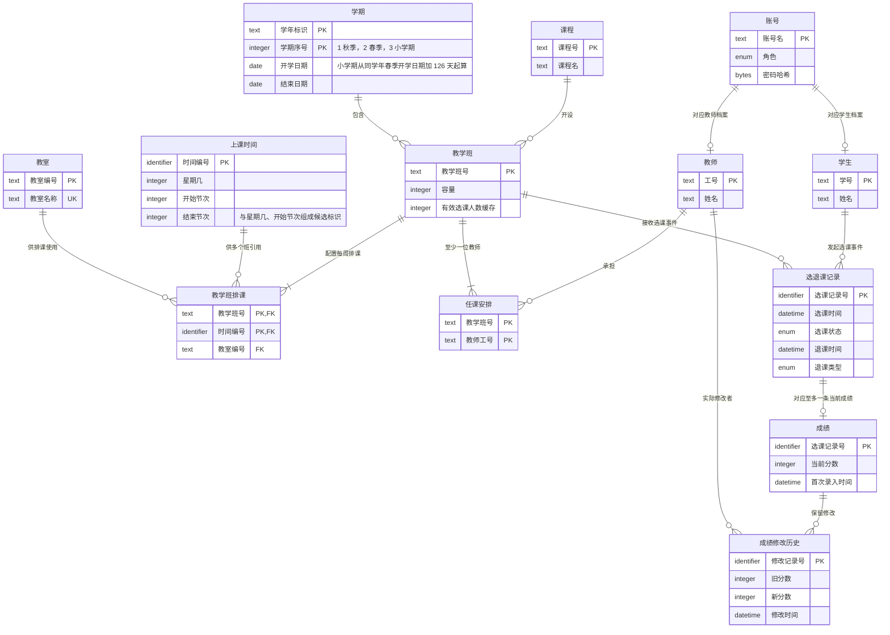
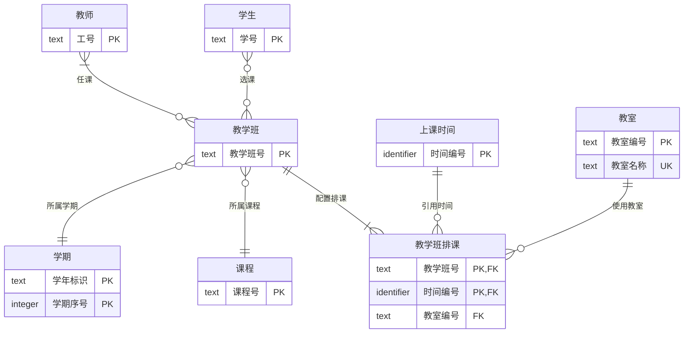

# 高校教学管理系统数据库概念结构设计

## 1. 背景与范围

本设计整理了高校教学管理系统数据库的实体、属性、候选标识、实体联系和 E-R 图。系统管理账号、学生、教师、课程、学期、教学班、教室、上课时间、教学班排课、任课安排、选退课和成绩，支持多教师合授、退课后重选及成绩修改历史。

沿用任务一的范围：单用户顺序操作，全学期每周重复固定节次，每条排课使用一间教室，全部任课教师占用本班全部时段。同一门课程可在不同学期分别开班。每个教学班仅属于一个学期，排课只在所属学期的起止日期内生效，禁止跨学期开班或延续排课。不增加并发选课、自动排课、院系、专业、行政班、学费、考勤或通用操作审计。成绩修改历史属于成绩业务记录。账号实体不设启用状态，项目不提供账号停用流程。

本阶段形成概念模型。表中的属性域表示业务含义，图中的 PK 表示选定的概念标识；SQL 数据类型与长度、主外键落点、索引、关系模式和范式分析由后续任务完成。

## 2. 实体与属性

模型共包含 13 个实体型及关联对象。候选标识指能够最小地唯一识别对象的属性集合，不根据姓名、课程名、日期或时间戳擅自推定唯一性。学生、教师和课程采用满足当前业务的最少基础字段。

| 编号 | 实体或关联对象 | 主要属性                                                         | 候选标识及选定标识                                           | 设计依据                                                              |
| ---- | -------------- | ---------------------------------------------------------------- | ------------------------------------------------------------ | --------------------------------------------------------------------- |
| E01  | 账号           | 账号名、角色、密码哈希                                           | 账号名。                                                     | 统一管理登录身份、角色权限和密码凭据；管理员以 admin 账号和角色表示。 |
| E02  | 学生           | 学号、姓名                                                       | 学号；专属账号也可通过一对一联系唯一定位学生。选定学号。     | 学生业务身份与登录身份分离，不假定学号等于账号后六位。                |
| E03  | 教师           | 工号、姓名                                                       | 工号；专属账号也可通过一对一联系唯一定位教师。选定工号。     | 支持教师资料、合授安排和成绩修改人追溯。                              |
| E04  | 课程           | 课程号、课程名                                                   | 课程号。                                                     | 课程可跨学期开设多个教学班，排课和容量属于教学班。                    |
| E05  | 学期           | 学年标识、学期序号、开学日期、结束日期                           | （学年标识，学期序号）。                                     | 区分不同学期，统一确定开学日期及选退课时间窗口。                      |
| E06  | 教学班         | 教学班号、容量、有效选课人数                                     | 教学班号。                                                   | 所属课程、学期通过联系表达，教室和上课时间由排课指定。                          |
| E07  | 上课时间       | 时间编号、星期几、开始节次、结束节次                             | 选定时间编号。星期几、开始节次和结束节次的组合也是候选标识。 | 同一每周时段可独立存在并被多个教学班引用。                            |
| E08  | 任课安排       | 对应教学班、对应教师；无额外联系属性                             | （教学班号，教师工号）。                                     | 承载教师与教学班的多对多联系，同班同教师只安排一次。                  |
| E09  | 选退课记录     | 选课记录号、选课时间、状态、退课时间、退课类型；关联学生和教学班 | 独立的选课记录号。                                           | 同一学生退课后可重选同班，必须区分多次选课事件。                      |
| E10  | 成绩           | 当前分数、首次录入时间；依赖所属选课记录                         | 所属选课记录号。                                             | 一次选课至多有一份当前成绩，未录入时没有成绩对象。                    |
| E11  | 成绩修改历史   | 修改记录号、旧分数、新分数、修改时间；关联成绩和修改教师         | 独立的修改记录号。                                           | 每次修改单独留痕，保留历史分数及实际修改人。                          |
| E12 | 教室 | 教室编号、教室名称 | 选定教室编号，教室名称也全校唯一。 | 一间教室可供多条排课分时使用。 |
| E13 | 教学班排课 | 教学班号、时间编号、教室编号 | （教学班号，时间编号）。 | 每条排课指定一个班、一个上课时间和一间教室。 |

### 2.1 基础属性与取值约束

| 对象             | 属性要求                                                                                                                                                                                                                                                                                                                         |
| ---------------- | -------------------------------------------------------------------------------------------------------------------------------------------------------------------------------------------------------------------------------------------------------------------------------------------------------------------------------- |
| 账号             | 账号名为 admin、s 加六位数字或 t 加六位数字，须与角色匹配。密码凭据只存密码哈希。算法与迭代次数由应用配置，密码盐由应用按任务一规则推导，这三项均不入库。                                                                                                                                                                        |
| 学生、教师、课程 | 各自标识、姓名或课程名必填。姓名及课程名允许重复，账号名不替代学号或工号。                                                                                                                                                                                                                                                       |
| 学期             | 学年标识与学期序号联合唯一。每学年设三个学期，按秋季、春季、小学期编号为 1、2、3。秋季和春季各 18 周，小学期 4 周。开学日期为周日且创建后固定。小学期独立编号为 3，开学日期为同一学年春季学期开学日期加 126 天，即按春季周序顺延至第 19 周的周日，也是春季结束日期的次日。各学期的结束日期为开学日期加教学周数 × 7 天再减 1 天。 |
| 教学班           | 班号格式为“学年标识-学期序号-流水号”，如 2024-2025-1-001。前缀与实际所属学期一致，班号及所属学期创建后固定，旧号永久不再发放。每个班通过排课关联教室。容量为正整数，创建后固定；有效选课人数为非负整数，不超过容量。所属课程、学期、教室、上课时间和教师通过联系表达。                                                 |
| 上课时间         | 星期几按周一至周日编码为 1 至 7。开始、结束节次均为 1 至 13 的整数，结束不小于开始，区间含首尾。星期几与首尾节次组合全校唯一。                                                                                                                                                                                                   |
| 教学班排课       | 每班至少关联一个上课时间，同班关联的时段互不重叠。已被引用的上课时间保持固定，需要调整某班排课时按 C12 校验后更换该班的关联。                                                                                                                                                                                                    |
| 教室             | 教室编号和完整教室名称各自唯一。名称格式见第 2.3 节。教室管理不记录座位数，排课不按教室座位数校验，选课人数上限由教学班容量决定。                                                                                                                                                                                                                                                                                             |
| 选退课记录       | 每条记录必须关联一名学生和一个教学班，选课时间必填。状态为“有效”或“已退课”；有效时退课时间和类型均为空，已退课时均必填，类型为常规或期中，退课时间不早于选课时间。                                                                                                                                                               |
| 成绩             | 成绩对象存在时，当前分数和首次录入时间必填。分数为 0 至 100 的整数，缺考录入 0 分；首次录入时间不得早于选课时间，修改时不能重置该时间。                                                                                                                                                                                          |
| 成绩修改历史     | 旧分数、新分数均为 0 至 100 的整数。每条历史必须对应一份成绩和一名实际修改教师，修改时间处于首次录入后不超过 168 小时的范围内。首次录入不记作一次修改。                                                                                                                                                                          |

时间编号标识独立的上课时间。同一星期几的第 1 至 2 节和第 1 至 3 节是两条不同定义，因此自然候选标识需要同时包含开始和结束节次。教学班排课以“教学班号＋时间编号”为联合标识。同一班同一时间只对应一间教室，因此教室编号是外键，不参与主键。

选退课记录不能用“学生＋教学班”作为全部历史的唯一标识，也不能仅靠选课时间保证唯一。成绩按一次选课识别，不能用“学号＋课程号”混合不同学期的成绩。

### 2.2 节次与上课时间

| 节次 | 北京时间    |
| ---- | ----------- |
| 1    | 08:00–08:45 |
| 2    | 08:50–09:35 |
| 3    | 09:50–10:35 |
| 4    | 10:40–11:25 |
| 5    | 11:30–12:15 |
| 6    | 14:05–14:50 |
| 7    | 14:55–15:40 |
| 8    | 15:45–16:30 |
| 9    | 16:40–17:25 |
| 10   | 17:30–18:15 |
| 11   | 18:30–19:15 |
| 12   | 19:20–20:05 |
| 13   | 20:10–20:55 |

上课时间与教学班排课分别建表。上课时间表定义可复用的每周时段，教学班排课表用“教学班号＋时间编号”关联两者，并用教室编号引用对应教室。同一班的不同时间可以分配到不同教室。每个时段覆盖首尾之间的全部节次。例如周二第 3 至 4 节显示为 09:50–11:25，每周计 2 节。两班可以共用这条时间定义，教室和教师仍须满足冲突限制。删除一个班时，该班的排课关联按 C13 清除，共享的上课时间继续保留。

### 2.3 教室编号与名称

教室名称采用“区号区楼号教房间号”。区号为 1 至 4。第 1、2、4 区各有 1 至 5 教，第 3 区有 1 至 3 教。各栋楼均有 5 层，每层房间尾号为 01 至 27。房间号由一位楼层号和两位房间尾号组成，例如 1 区 1 教一层为 101–127，名称写作 `1区1教101` 至 `1区1教127`。同一房间号可出现在不同区或楼栋，完整教室名称全校唯一。

| 区域 | 教学楼 | 每层房间数 | 教室数 |
|---|---|---:|---:|
| 1 区 | 1–5 教 | 27 | 675 |
| 2 区 | 1–5 教 | 27 | 675 |
| 3 区 | 1–3 教 | 27 | 405 |
| 4 区 | 1–5 教 | 27 | 675 |
| 合计 | 18 栋 | | 2430 |

教室编号独立标识教室，教室名称为另一候选标识。教室名称用于课表显示，排课通过教室编号关联。

## 3. 实体联系

下表中的数量按单个对象解释：给定左方一个对象，可关联多少右方对象；反方向同理。0..N 表示零个或多个，1..N 表示至少一个。

| 编号 | 左方—联系—右方             | 左方对应右方 | 右方对应左方 | 设计依据                                             |
| ---- | -------------------------- | ------------ | ------------ | ---------------------------------------------------- |
| R01  | 账号—学生身份—学生         | 0..1         | 1            | 每名学生恰有一个学生账号，其他角色账号没有学生身份。 |
| R02  | 账号—教师身份—教师         | 0..1         | 1            | 每名教师恰有一个教师账号，其他角色账号没有教师身份。 |
| R03  | 课程—开设—教学班           | 0..N         | 1            | 课程可以尚未开班，也可在同学期或跨学期开多个班。     |
| R04  | 学期—安排—教学班           | 0..N         | 1            | 学期可以先建立，每个教学班只属于一个学期。           |
| R05  | 教学班—配置—教学班排课     | 1..N         | 1            | 每班至少配置一个上课时间。                           |
| R06  | 教师—承担—任课安排         | 0..N         | 1            | 教师可以暂未任课，也可参与多个班。                   |
| R07  | 教学班—配置—任课安排       | 1..N         | 1            | 每班至少一位教师，允许多教师合授。                   |
| R08  | 学生—产生—选退课记录       | 0..N         | 1            | 学生可以没有选课，也可产生多次选退课记录。           |
| R09  | 教学班—接收—选退课记录     | 0..N         | 1            | 新班可以无人选课，历史记录总数不直接受容量限制。     |
| R10  | 选退课记录—取得—成绩       | 0..1         | 1            | 未录入时无成绩，录入后只保留一份当前成绩。           |
| R11  | 成绩—保留—成绩修改历史     | 0..N         | 1            | 成绩可以从未修改，每次修改都保留独立历史。           |
| R12  | 教师—执行—成绩修改历史     | 0..N         | 1            | 每次修改恰由一位教师执行，教师必须任教对应教学班。   |
| R13  | 上课时间—供引用—教学班排课 | 0..N         | 1            | 一个时间可由多个班引用，每条排课只引用一个时间。     |
| R14 | 教室—供使用—教学班排课 | 0..N | 1 | 一间教室可被多条排课分时使用，每条排课使用一间教室。 |

### 3.1 一对一与多对多联系

账号与学生、账号与教师，以及选课记录与成绩，最大基数均为一对一。学生和教师必须拥有对应账号；账号的学生、教师绑定互斥且与角色匹配，admin 两者均不绑定。这项互斥规则需要文字补充，不能仅由两条可选一对一连线保证。

教师与教学班为多对多联系，通过任课安排表达。任课安排没有需求之外的主讲身份、顺序或比例属性，不额外设置无用途的任课安排号。不能把多名教师拼接到教学班的一个属性中。

学生与教学班为多对多联系，通过选退课记录表达。选课时间、状态和退课信息属于一次选课事件。退课更新原记录，重选新增记录。同一学生和教学班之间可存在多条历史记录，至多有一条有效记录。教学班整体删除时，按 C13 清除该班的全部记录。

教学班与上课时间为多对多联系，通过教学班排课表达。教室与教学班排课为一对多联系。每条排课对应一间教室，一间教室可以被多条排课分时引用。

## 4. E-R 图

### 4.1 完整 E-R 图

完整图包含全部 13 个对象及 14 条联系。图中的 text、integer、date 等为概念属性域；多列 PK 表示联合标识，FK 表示外键，UK 表示唯一的候选标识。静态图和 Mermaid 使用同一组对象及联系，成绩与选退课状态的业务约束见第 5 节。

以下为对应的可编辑 Mermaid 代码；使用不支持 Mermaid 的阅读器时，可直接查看上图。

### 4.2 核心联系图

核心联系图显示选课、任课、排课三个多对多联系，以及排课与教室的联系。课程和学期也直接关联教学班。

核心联系图的 Mermaid 源码如下。核心图显示教学班排课实体，以明确教室分配到每条排课。选退课记录及任课安排见完整图。

## 5. 业务约束清单

E-R 图表示结构和联系基数。条件唯一性、时间窗口、权限、冻结和事务一致性需由文字补充，并在后续数据库及应用设计中落实。

| 编号 | 规则                                                                                                                                                                                                                       | 对应需求            | 后续保障方式                                                                                            |
| ---- | -------------------------------------------------------------------------------------------------------------------------------------------------------------------------------------------------------------------------- | ------------------- | ------------------------------------------------------------------------------------------------------- |
| C01  | 各标识唯一，账号格式、角色和人员绑定匹配且互斥；学生和教师可修改本人密码或由管理员重置，管理员密码永久固定。                                                                                                               | BR-02、BR-03、BR-13 | 唯一性与引用约束，统一创建及权限校验流程。                                                              |
| C02  | 每个教学班恰属一门课程和一个学期，排课只在所属学期内生效，至少有一条排课和一位教师，每条排课关联一个上课时间和一间教室；全部任课教师占用本班全部时段。                                                                                                             | BR-04               | 创建教学班时完整保存班、排课关联和任课安排，避免半成品。                                                |
| C03  | 同班时段不重叠；同学期跨班时段重叠时，两条排课不得使用同一教室或共享教师，不重叠时可复用。                                                                                                                                           | FR-01、BR-04        | 校验星期、节次范围并查询相关时段与任课安排；不能仅用单行 CHECK 判断跨行冲突。                           |
| C04  | 同课程同学期各班每周总课时相同，具体时段可以不同。                                                                                                                                                                         | FR-01、BR-04        | 对各班时段的“结束节次－开始节次＋1”求和比较；无选课历史的班修改课程或时段时重新核验。                   |
| C05  | 同一学生、同一学期、同一课程最多一条有效选课；已退历史及其他学期不阻止选课。                                                                                                                                               | BR-06、BR-12        | 校验有效记录及班所属课程、学期，不对全部历史设置“学生＋班”无条件唯一限制。                              |
| C06  | 新选班不得与本学期已有有效选课时段重叠。                                                                                                                                                                                   | BR-12               | 沿有效选课定位教学班及时段，按区间相交规则核验。                                                        |
| C07  | 有效人数＝当前有效选课记录数，且 0≤有效人数≤容量；成功选课加一、退课减一，记录与缓存同一事务更新，失败全部回滚。                                                                                                           | BR-05、BR-11        | 单对象范围约束、计数核对和选退课事务；跨表计数一致性不能仅靠 CHECK。                                    |
| C08  | 退课保留原记录及时间、类型；重选新增记录。有效记录无退课信息，已退记录的两项退课信息必须齐全。                                                                                                                             | FR-04、BR-06        | 状态与字段一致性检查及退课流程校验，禁止重复退课。                                                      |
| C09  | 开学周日为第 1 周首日。春季、秋季第 1 至 3 周可选退课，第 10 周周日至周三仅退课，每名学生当学期最多额外退一门。小学期开学日期为同一学年春季开学日期加 126 天，从开学当天起仅开放 3 天常规选退课，无期中退课窗口。          | BR-07               | 按北京时间和开学日期计算窗口，按学生和学期统计现存的期中退课记录。被删除教学班的退课记录不再计入。      |
| C10  | 仅对有效选课录成绩，已有成绩禁止退课；0 分有效，未录成绩与 0 分不同。教师只能处理自己任教班的成绩。                                                                                                                        | BR-08、BR-09        | 选课状态、成绩存在性、任课关系及分数范围双向核验。                                                      |
| C11  | 成绩可在首次录入后不超过 168 小时修改，恰好满 168 小时允许。修改历史保留旧值、新值、教师和时间，当前分数与历史同事务更新。                                                                                                 | FR-05、BR-08、BR-11 | 固定首次录入时间，核验期限和权限，改分时追加历史，任一步失败回滚。教学班整体删除时按 C13 清除相关历史。 |
| C12  | 班号、所属学期、容量、任课教师在创建后固定。产生过选课记录后，所属课程及每条排课的时间和教室也冻结。                                                                                                                                 | FR-01、BR-04        | 检查全部历史记录，当前有效人数归零不解除冻结。                                                          |
| C13  | 仅管理员可删除教学班。在同一事务中删除该班的成绩修改历史、成绩、选退课记录、任课安排、教学班排课及教学班。课程、学期、人员、教室、上课时间、其他班的数据和公共节次定义继续保留。学生、教师、课程及教室的删除限制见 BR-13。 | BR-13               | 按依赖顺序删除该班专属数据，或由等效的外键级联实现。任一步失败全部回滚，发号状态继续保留。              |
| C14  | 班号永久唯一，前缀必须与实际所属学期一致。创建后不得换学期或修改班号，所有已发班号均不再发放。                                                                                                                             | FR-01、BR-04        | 发号时按实际学期生成前缀，按学期持久化已发号流水上限。删除班级不回退流水上限。                          |

时段判定：同一学期、同一星期几，含首尾节次区间 [a,b] 与 [c,d] 在 a≤d 且 c≤b 时重叠。例如第 1 至 2 节与第 2 至 3 节冲突，与第 3 至 4 节不冲突。

各学期分别以本学期开学周日的北京时间 00:00 为 S。小学期以同一学年春季学期为计算依据，管理员创建小学期前应先建立春季学期。春季和秋季的常规选退课窗口为 [S, S＋21 天)，期中退课窗口为 [S＋63 天, S＋67 天)。小学期的常规选退课窗口为 [S, S＋3 天)，无期中退课窗口。

所有受限操作均核验账号及角色：管理员随时查看全部班的当前有效学生名单和名额；教师随时查看自己任教班；学生可浏览教学班，个人课表、选退课记录和成绩仅限本人查询，无权查询其他学生的明细或删除任何教学班。学生仅在常规选课阶段看到容量、有效人数和剩余名额并按余量筛选。期中退课后有效人数减少、计算余量增加，但学生仍不能选课或查看名额。

## 6. 冗余处理与业务查询

### 6.1 属性取舍

| 信息               | 处理决定                                   | 原因                                                                                                                           |
| ------------------ | ------------------------------------------ | ------------------------------------------------------------------------------------------------------------------------------ |
| 有效选课人数       | 保留为受控缓存。                           | 任务一要求选退课记录与人数同步更新，缓存始终等于有效记录数。                                                                   |
| 剩余名额           | 按“容量－有效人数”计算，不单独存储。       | 避免重复维护；是否允许选课由时间窗口和权限另行决定。                                                                           |
| 每周总课时         | 合计本班互不重叠时段的节次数。             | 不与具体时段重复保存，同课同学期比较合计值。                                                                                   |
| 绩点               | 根据当前分数计算，不单独存储。             | 低于 60 分为 0；60—69 为 1.0，70—79 为 2.0，80—89 为 3.0，90—100 为 4.0。                                                      |
| 课程统计           | 按单班或课程＋学期实时汇总。               | 选课、退课和任课安排分别按记录计数，重选另计；有效学生人数在统计范围内按学生去重。                                             |
| 成绩统计           | 仅统计有效选课且已录入的当前成绩。         | 平均绩点先逐条换算再求平均；及格为不低于 60 分，满绩为不低于 90 分。无已录成绩时两项平均值显示“暂无成绩”，及格和满绩人数为零。 |
| 教师列表、时段列表 | 分别用任课安排、教学班排课与上课时间表达。 | 不保存逗号列表或“教师1、教师2”等重复属性。                                                                                     |
| 历史旧分数、新分数 | 保存每次修改的快照。                       | 历史是业务事实，不随当前分数覆盖。                                                                                             |
| 教室、管理员       | 教室为独立实体，管理员为账号角色。         | 教学班排课引用教室编号，教室名称按编号查询。                                                                             |

### 6.2 核心关联查询

| 查询                   | 关联路径与要求                                                                                                                |
| ---------------------- | ----------------------------------------------------------------------------------------------------------------------------- |
| 学生修读及成绩明细     | 学生→选退课记录→教学班→课程、学期，并可选关联成绩；以当前登录账号对应的学生和所选学期查询本人记录，保留未录成绩及已退课记录。 |
| 教师教学班名单         | 教师→任课安排→教学班→有效选课记录→学生，并可选关联成绩；展示学号、姓名、名单及名额，教师只查任教班。                          |
| 按任意合授教师姓名查班 | 匹配教师及任课安排定位教学班，再关联课程、学期及教学班排课，展示全部教师与每条排课的时间和教室名称，不能只显示命中的一名教师。          |
| 单班或课程＋学期统计   | 分别聚合选课记录、退课记录、任课安排、有效学生及当前成绩，再组合结果；避免合授、多时段或多条成绩历史令计数和平均值重复放大。  |

以上查询可覆盖课程要求的至少一个涉及三张及以上表的业务查询；SQL 与实际运行结果由后续任务提交。
