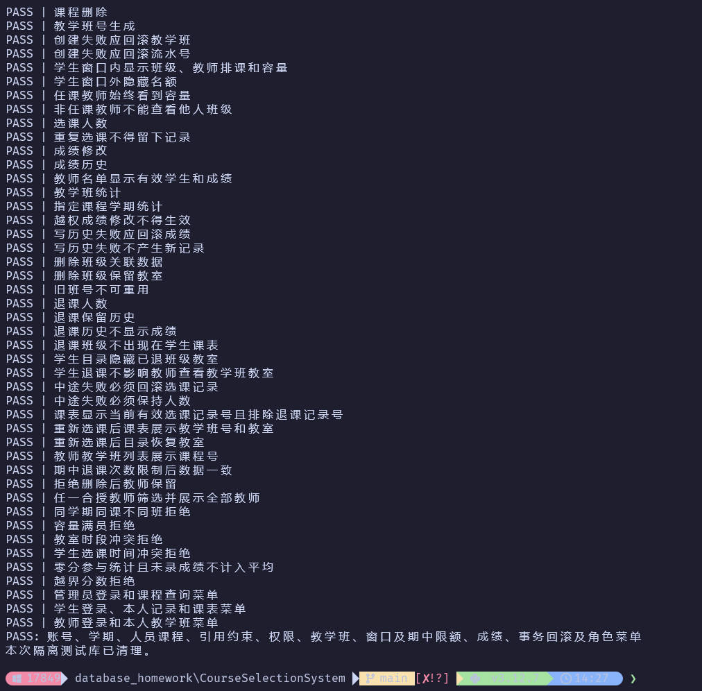

# 功能测试报告

本报告记录 24 项通过的用例，覆盖课程增删改查、完整性约束、选退课边界、多表查询及事务回滚。

## 测试环境与数据

系统为 Java 命令行程序，项目指定 MySQL Connector/J 9.7.0，任务四运行记录使用 MySQL 8.0.41。课程 CRUD 采用已有菜单实测［A］，事务使用隔离 MySQL 样本和固定时间［B］，Q08 使用任务四基线样本［C］。

## 1 课程增删改查与外键约束

| 编号 | 测试输入与操作 | 预期结果 | 实际结果与证据 | 结果 | 问题与修复 |
| --- | --- | --- | --- | --- | --- |
| T01 | 管理员登录后选 1 查询课程。 | 进入管理员菜单并返回课程列表。 | 登录成功，列表显示 C001 数据库原理等记录。［A］ | 通过 | 无 |
| T02 | 新增课程 `C_SCREENSHOT_01`，课程名填“测试课程”，再查列表。 | 新增成功，课程可查。 | 提示“添加成功”，列表出现该编号和课程名。［A］ | 通过 | 无 |
| T03 | 再次新增课程 `C_SCREENSHOT_01`。 | 主键拒绝重复编号，菜单仍可使用。 | 程序提示主键重复，随后返回管理员菜单。［A］ | 通过 | 无 |
| T04 | 将 `C_SCREENSHOT_01` 改名为“修改后的测试课程”，再查列表。 | 只更新指定课程，影响 1 行。 | 显示“更新记录数: 1”，再次查询显示新名称。［A］ | 通过 | 无 |
| T05 | 尝试修改样本中不存在的课程 `C_MISSING`。 | 影响行数为 0，程序继续运行。 | 显示“更新记录数: 0”，返回管理员菜单。［A］ | 通过 | 无 |
| T06 | 删除无教学班引用的课程 `C_SCREENSHOT_01`，再查列表。 | 删除 1 行，再查时课程消失。 | 显示“删除记录数: 1”，列表已查不到该编号。［A］ | 通过 | 无 |
| T07 | 尝试删除仍被教学班引用的 C001，再查列表。 | 外键阻止删除，课程仍可查。 | 提示外键约束失败，列表仍有 C001 数据库原理。［A］ | 通过 | 无 |

## 2 选课、退课与边界

隔离样本的春季学期始于 2026 年 3 月 1 日。测试直接将时间传给服务层，按相同规则验证窗口内外行为。001、002 等为样本班号的尾号。

| 编号 | 测试输入与操作 | 预期结果 | 实际结果与证据 | 结果 | 问题与修复 |
| --- | --- | --- | --- | --- | --- |
| T08 | 小学期开学前 1 秒、开学时、第 3 天末与第 4 天 0 点。 | 开学起的 3 天内开放常规选退课。 | 四个时点依次判定为关闭、开放、开放、关闭。［B］ | 通过 | 无 |
| T09 | 3 月 2 日 10:00，`S_TEST` 首次选中容量为 1 的班。 | 选课成功，有效人数由 0 变 1。 | 成功写入选课，有效人数查得 1。［B］ | 通过 | 无 |
| T10 | `S_TEST` 以相同时刻再次选同一班。 | 重复选课被拒，记录不增加。 | 操作被拒，选课记录总数仍为 1。［B］ | 通过 | 无 |
| T11 | `S_TEST` 已选 `C_TEST`，再申请同学期该课程的另一班。 | 拒绝同学期同一课程的重复选课。 | 提示该学生已选同一课程。［B］ | 通过 | 无 |
| T12 | 容量为 2 的班已有两名学生，`S_THREE` 申请选课。 | 因名额已满拒绝第三名学生。 | 提示该班名额已满。［B］ | 通过 | 无 |
| T13 | `S_TEST` 选中 002 班，1 分钟后退课，再选回原班。 | 保留退课历史、扣减有效人数，重选另建记录。 | 退课后人数为 0，保留 1 条退课历史。重选后课表使用新记录号。［B］ | 通过 | 按选课记录号区分每次选课。 |
| T14 | 5 月 3 日 10:00 期中退一门，1 分钟后申请退第二门。 | 同学期只允许一次期中退课。 | 第二次退课被拒，仍有 1 条有效选课。［B］ | 通过 | 无 |
| T15 | 窗口关闭后以学生身份浏览教学班，再按余量筛选。 | 普通列表能查班，筛选给出窗口提示。 | 列表显示班号，隐藏容量和余量。筛选提示“不能使用余量筛选”。［B］ | 通过 | 补充窗口外余量筛选提示。 |

T13 同时检查学生的个人课表。退课后对应班级从课表移除，重选后课表恢复该班及教室，并显示本次有效选课记录号。

## 3 事务回滚、多表查询与修复回归

T16 和 T17 在事务第二次写入时触发数据库异常，再查询记录数、有效人数和成绩，核对回滚结果。

| 编号 | 测试输入与操作 | 预期结果 | 实际结果与证据 | 结果 | 问题与修复 |
| --- | --- | --- | --- | --- | --- |
| T16 | 在学生重选时，用测试触发器阻止更新教学班人数。 | 人数更新失败，回滚已写入的选课。 | 重选抛出异常。库里仅有原来的 1 条退课记录，有效人数仍为 0。［B］ | 通过 | 无 |
| T17 | 将 90 分改成 80 分，用测试触发器阻止写改分历史。 | 写入历史失败，成绩恢复到改分前。 | 捕获异常，成绩仍是 90 分，改分历史仍为 1 条。［B］ | 通过 | 无 |
| T18 | 创建与教师已有排课时段冲突的教学班。 | 拒绝创建，班级和班号计数与操作前一致。 | 建班被拒，只有原班，流水号仍为 1。［B］ | 通过 | 无 |
| T19 | 管理员按“教师二”筛选合授教学班。 | 查到该班，结果列出两位任课教师。 | 查到该班，教师列同时含“测试教师”和“教师二”。［B］ | 通过 | 无 |
| T20 | 任课教师查只有一名有效学生的 001 班名单和统计。 | 名单显示学生与成绩，统计与样本一致。 | 名单含 `S_TEST`、90 分。统计有效 1 人、均分 90、满绩 1 人。［B］ | 通过 | 无 |
| T21 | 管理员分别查错误班号和已建但尚无有效选课的名单。 | 错误班号与空班给出不同提示。 | 前者提示“教学班不存在”，后者提示“暂无有效选课学生”。［B］ | 通过 | 增加班号存在性检查及空名单提示。 |
| T22 | 分别查 `S_TEST` 未录成绩记录和 `S_TWO` 的 0 分成绩。 | 区分未录成绩和 0 分，0 分计入统计。 | 未录显示“暂无绩点”。0 分显示绩点 0.0，计入平均分。［B］ | 通过 | 按是否已录成绩显示分数和绩点。 |
| T23 | 用基线样本执行 Q08，核对 2025–2026 学年第 2 学期 C001。 | 合授和改分历史不造成统计重复。 | 查得 15 条选课、2 条已退、13 名有效学生、3 条任课，均分 72.33。［C］ | 通过 | 改为带别名的 ON 连接，复跑通过。 |
| T24 | 查 `S_TEST` 在 3 月 2 日 10:01 和 5 月 3 日 10:00 的退课记录。 | 显示退课类型和时间。 | 第一条显示常规退课和 10:01，第二条显示期中退课和 10:00。［B］ | 通过 | 按学期窗口判别类型并显示退课时间。 |

## 4 运行证据与复测



图 1 任务五隔离库实跑截图。图中可见选课和成绩事务中途失败后的断言，以及测试库清理结果。

- ［A］[说明与功能测试](../JDBC应用编程/说明与功能测试.md)第 2–5 节及[运行图片](../JDBC应用编程/运行图片)。
- ［B］[业务测试记录](../CourseSelectionSystem/业务测试记录.md)、[RulesTest.java](../CourseSelectionSystem/src/test/java/edu/coursework/RulesTest.java)、[IntegrationTest.java](../CourseSelectionSystem/src/test/java/edu/coursework/IntegrationTest.java)及图 1。T08 在本次规则测试中复测通过。
- ［C］[MySQL 实际运行记录](../物理设计与SQL实现/运行证据/MySQL实际运行.txt)的 Q08 段落。

在 CourseSelectionSystem 目录运行以下命令。第一条执行 JDBC 集成测试，第二条复测 SQL 基线与扩充样本。

```powershell
python .\run_integration_test.py
python .\verify_task4_fixtures.py
```
