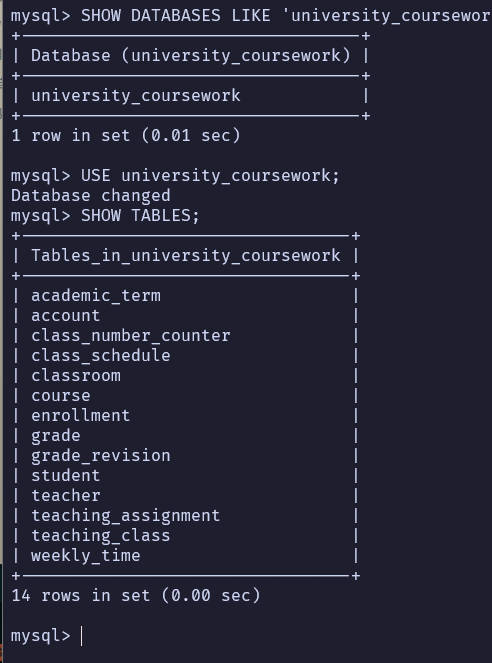
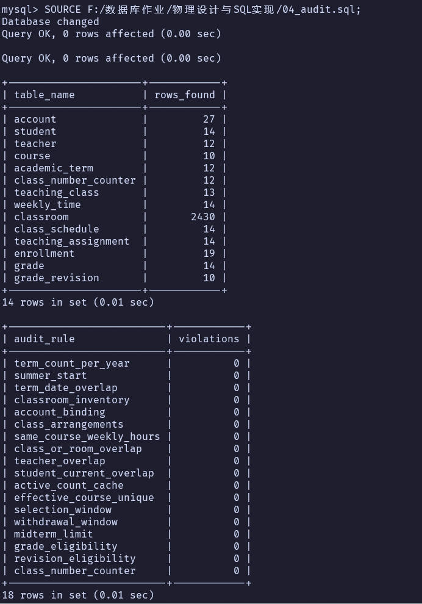
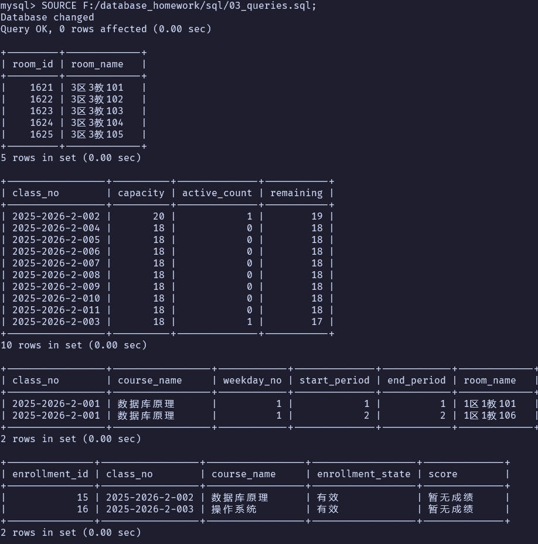
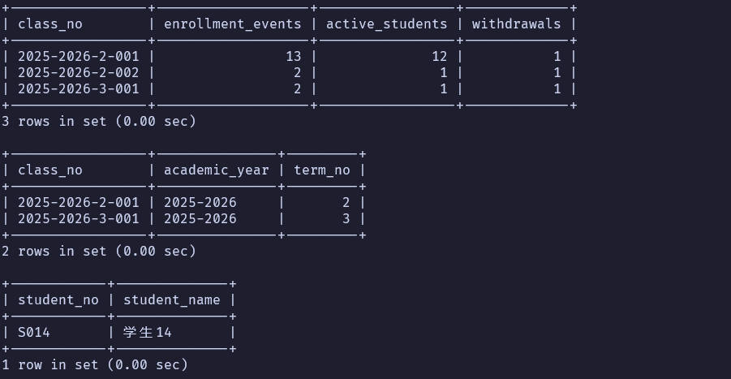
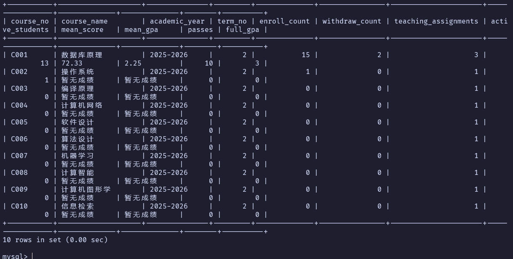
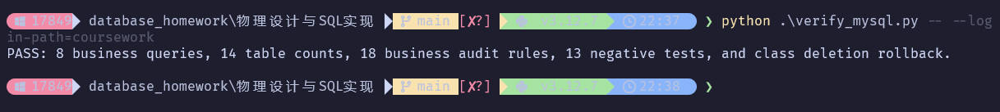

# 物理实现运行说明

以下路径以**仓库根目录**为当前工作目录：先在仓库根目录的 PowerShell 启动 MySQL，再执行 `mysql>` 中的相对路径命令。截图保留当时运行的历史结果。

## 1. 版本和登录

```sql
SELECT VERSION();
```


## 2. 创建数据库及初始化

仅在不存在同名数据库时执行一次。

```sql
SOURCE CourseSelectionSystem/sql/01_create.sql;
SOURCE CourseSelectionSystem/sql/02_seed.sql;
SHOW DATABASES LIKE 'university_coursework';
USE university_coursework;
SHOW TABLES;
```



## 3. 表记录数与一致性检查

```sql
SOURCE CourseSelectionSystem/sql/04_audit.sql;
```



## 4. 八条查询

```sql
SOURCE CourseSelectionSystem/sql/03_queries.sql;
```

Q01–Q04：



Q05–Q07：



Q08：



## 5. 非法数据检查

单独执行下列各条语句，截图 MySQL 返回的错误。

```sql
USE university_coursework;
INSERT INTO course VALUES ('C001', '重复课程');
UPDATE grade SET score = 101 WHERE enrollment_id = 1;
INSERT INTO class_schedule VALUES ('2025-2026-2-001', 3, 999999);
INSERT INTO classroom (room_name) VALUES ('3区4教101');
```


## 6. 自动验证与事务回滚

```powershell
python .\物理设计与SQL实现\verify_mysql.py --fixture baseline --no-evidence -- --login-path=coursework
```

已配置 `coursework` 登录路径时运行上面的命令；未配置时可先运行 `mysql_config_editor set --login-path=coursework --host=localhost --user=root --password`，按提示输入数据库密码。

原始样本使用 `--fixture baseline`；只有在原始样本上完整执行过 `05_s001_extra_courses.sql`、没有其他数据变更时，才使用 `--fixture s001`：

```powershell
python .\物理设计与SQL实现\verify_mysql.py --fixture s001 --no-evidence -- --login-path=coursework
```

扩充样本预期 22 条选课记录，Q07 包含 S001 和 S014。`--no-evidence` 保留现有历史记录；以上两种口径针对固定测试数据，不适用于任意业务数据。可在项目目录运行 `python .\verify_task4_fixtures.py`，在随机隔离库依次验证两种口径。以下截图是原始样本的历史结果。


