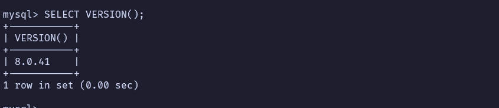
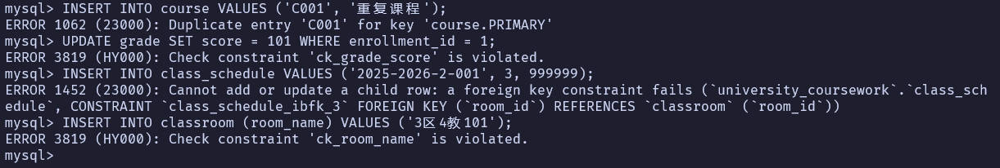

# 物理实现运行说明

## 1. 版本和登录

```sql
SELECT VERSION();
```



## 2. 创建数据库及初始化

仅在不存在同名数据库时执行一次。

```sql
SOURCE F:/database_homework/CourseSelectionSystem/sql/01_create.sql;
SOURCE F:/database_homework/CourseSelectionSystem/sql/02_seed.sql;
SHOW DATABASES LIKE 'university_coursework';
USE university_coursework;
SHOW TABLES;
```


## 3. 表记录数与一致性检查

```sql
SOURCE F:/database_homework/CourseSelectionSystem/sql/04_audit.sql;
```


## 4. 八条查询

```sql
SOURCE F:/database_homework/CourseSelectionSystem/sql/03_queries.sql;
```

Q01–Q04：


Q05–Q07：


Q08：


## 5. 非法数据检查

单独执行下列各条语句，截图 MySQL 返回的错误。

```sql
USE university_coursework;
INSERT INTO course VALUES ('C001', '重复课程');
UPDATE grade SET score = 101 WHERE enrollment_id = 1;
INSERT INTO class_schedule VALUES ('2025-2026-2-001', 3, 999999);
INSERT INTO classroom (room_name) VALUES ('3区4教101');
```



## 6. 自动验证与事务回滚

```powershell
mysql_config_editor set --login-path=coursework --host=localhost --user=root --password
cd 'F:\database_homework\物理设计与SQL实现'
python .\verify_mysql.py -- --login-path=coursework
```


